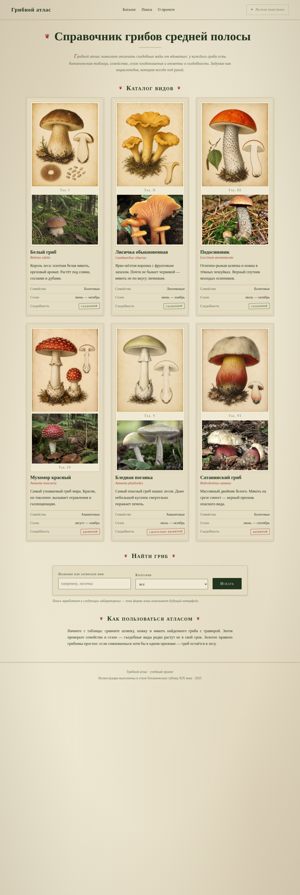
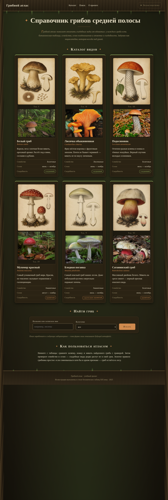

# Грибной атлас — лабораторная работа №2

**Русский** | [English](README.en.md)

Справочник грибов средней полосы в стиле винтажного ботанического атласа.
Интерактивное приложение на чистом JavaScript на основе
[TheLastie/Pract, ветка site](https://github.com/TheLastie/Pract/tree/site).

## Функционал ЛР №2

- Поиск в реальном времени без учёта регистра по названию, латинскому имени,
  описанию, семейству и сезону.
- Фильтр по категориям, включая «Все категории» и «Не определено».
- Сортировка А–Я, Я–А, по времени добавления в обоих направлениях.
- Модальная форма: закрытие крестиком, отменой, Escape и по подложке.
- Валидация через HTML5-атрибуты и `input.validity`; сообщения под полями.
- Удаление через один обработчик контейнера и `event.target.closest()`.
- Сохранение после добавления/удаления в `localStorage` с JSON.
  Ключ: `gribnoy-atlas:items:v1`. Пустой каталог сохраняется пустым.
- Единый объект `state`; `render()` строит DOM из состояния.

Пользовательский текст вставляется через `textContent`. Сортировка работает
с копией массива. Повреждённое или недоступное хранилище обрабатывается
с понятным сообщением. При добавлении сбрасываются фильтры и включается
порядок «Сначала новые записи», чтобы новая карточка была сразу видна.
Пользовательские записи отображаются без выдуманных иллюстраций.

Форк задания: [xDesh4ka/hello-web-lr-1](https://github.com/xDesh4ka/hello-web-lr-1)

## Для кого

Для начинающих грибников и всех, кто хочет научиться отличать
съедобные грибы от ядовитых по внешним признакам.

## Проверка ЛР №2

В Edge пройдены 35 браузерных проверок: поиск, совместные фильтры, сортировка,
валидация, четыре способа закрытия окна, добавление, удаление, безопасный вывод
HTML как текста, сохранение после перезагрузки, пустой каталог, повреждённое
и заблокированное хранилище. Проверены ширины 360, 768 и 1280 px и обе темы.

Для повторения запустите локальный сервер, затем выполните:

```sh
playwright-cli -s=lr2 open about:blank --browser=msedge
playwright-cli -s=lr2 --raw run-code --filename=tests/browser-check.js
```

Тест использует отдельный контекст браузера и не меняет ваши сохранённые записи.
Текущие скриншоты: `screenshot-lab2.png`, `screenshot-lab2-dark.png`,
`screenshot-lab2-mobile.png`. Файл проверки находится в `tests/browser-check.js`.

## Скриншоты исходной ЛР №1

| Светлая тема «Ботанический атлас» | Тёмная тема «Лесная подстилка» |
|---|---|
|  |  |

## Что на странице

- Шапка с названием и навигацией по разделам.
- Заголовок и краткое описание задачи проекта.
- Каталог из шести карточек: у каждой — ботаническая таблица, фотография,
  название, латинское имя, описание и свойства (семейство, сезон, съедобность).
- Форма поиска: текстовое поле и выбор категории.
- Блок «Как пользоваться атласом».
- Подвал.

## Особенности

- Две темы оформления, переключаемые чистым CSS (чекбокс + `:has()`, без JavaScript).
- Светлая — «ботанический атлас»: состаренная бумага, гравюры, печати.
- Тёмная — «лесная подстилка»: мох, кора, тёмная земля.
- Сетка карточек на CSS Grid, навигация и свойства — на Flexbox.
- Адаптивность: 360 px (1 колонка), 768 px (2), 1280 px (3).

## Как открыть

Откройте `index.html` в современном браузере — стили подключаются из `css/style.css`,
изображения лежат в `assets/images/`.

Установка зависимостей и сборка не нужны. Для стабильного адреса хранилища
рекомендуется локальный сервер: `python -m http.server 8000`, затем
открыть http://localhost:8000. В некоторых браузерах сохранение для `file://`
ограничено; приложение покажет сообщение. Без интернета используются
системные шрифты вместо Google Fonts.

## Структура проекта

```text
project-lab2/
├── index.html
├── css/
│   └── style.css
├── js/
│   └── app.js
├── assets/
│   └── images/         # иллюстрации и фото видов
├── screenshot-light.png
├── screenshot-dark.png
└── README.md
```

## К защите

- `state.items` хранит записи, остальные поля задают поиск, категорию и порядок.
  Событие меняет состояние, а `render()` заново строит карточки.
  Исходные шесть записей читаются из статических карточек ЛР №1 при запуске;
  далее список берётся из хранилища или из этих демонстрационных данных.
- `filter()` создаёт выборку, `[...filtered].sort()` сортирует копию.
- `textContent` выводит текст без интерпретации HTML и скриптов.
- Благодаря всплытию один слушатель контейнера обрабатывает клики по всем
  карточкам, включая добавленные. `closest()` находит кнопку удаления.
- `preventDefault()` отменяет стандартную отправку формы;
  `stopPropagation()` останавливает распространение события и здесь не нужен.
- `localStorage` хранит строки: массив преобразуется через `JSON.stringify()`,
  а при загрузке восстанавливается через `JSON.parse()`.
- `const` запрещает переназначение переменной, `let` допускает его. Обе имеют
  блочную область видимости и недоступны до инициализации (TDZ). У `var`
  область функции, до присваивания значение равно `undefined`; здесь `var` не используется.

## Иллюстрации

Гравюры-таблицы сгенерированы нейросетью в стиле ботанических таблиц XIX века.
Полевые фотографии лисички, подосиновика, бледной поганки и сатанинского гриба —
из датасета автора проекта; фото белого гриба и мухомора пока сгенерированы.
