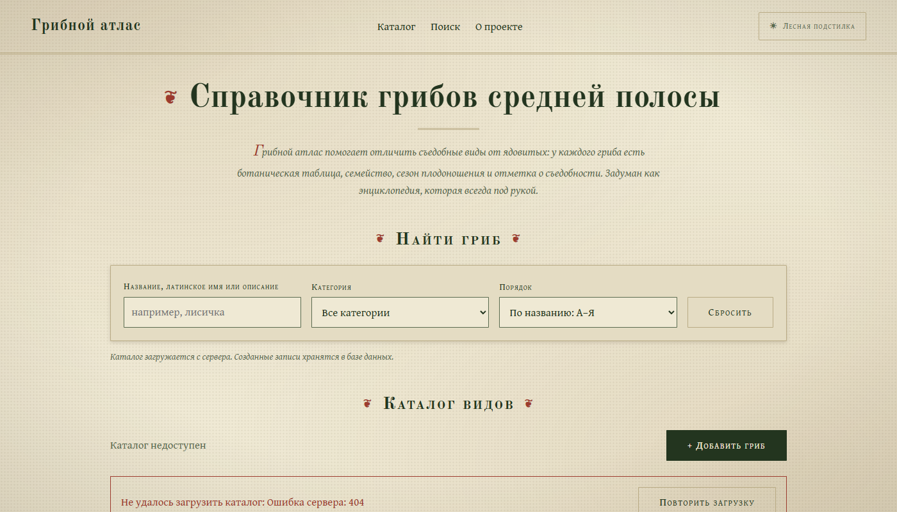
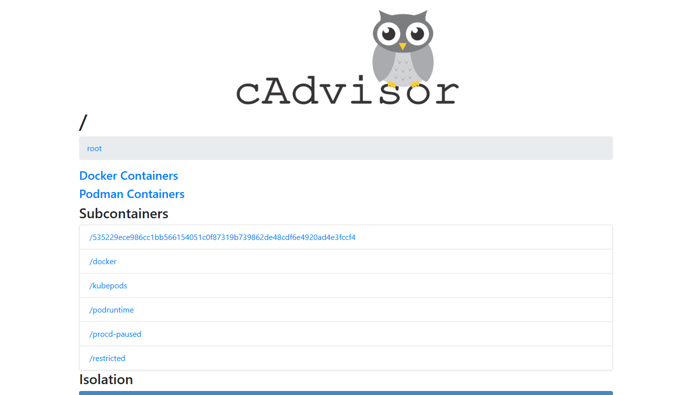
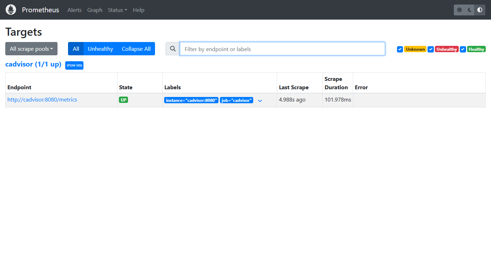
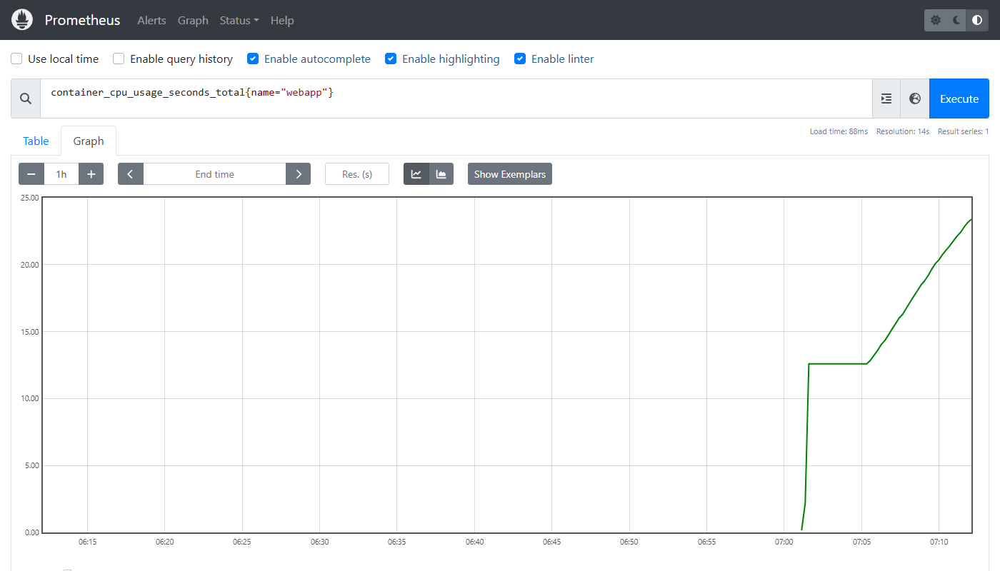
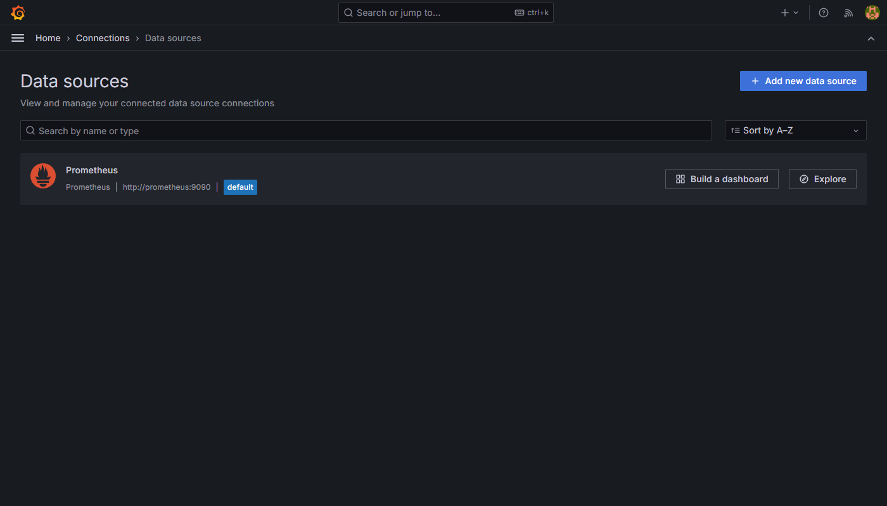
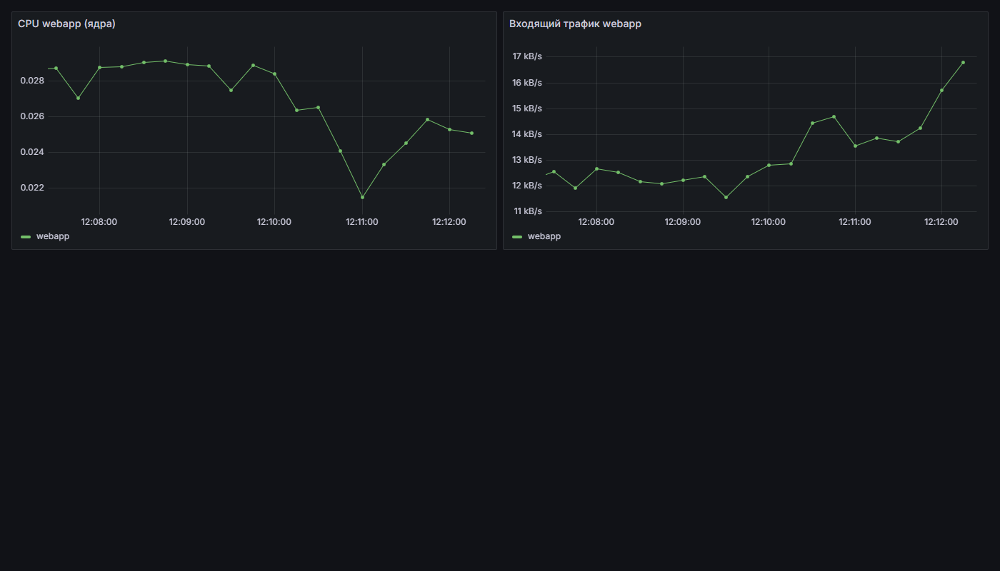
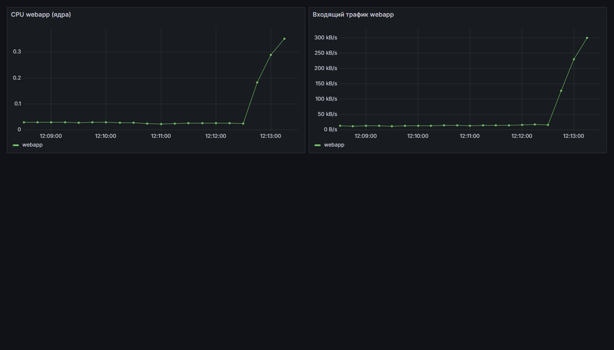
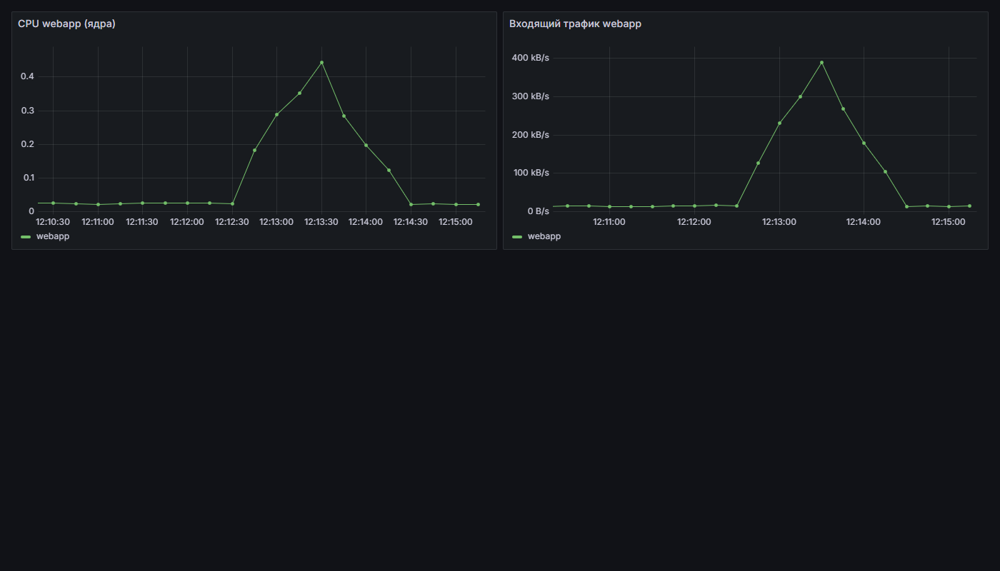

# Container monitoring: cAdvisor + Prometheus + Grafana

[Русская версия](README.md)

A Docker container monitoring stack. The test application `webapp` (nginx serving the mushroom atlas site) runs in a container. cAdvisor collects its container metrics, Prometheus stores them, and Grafana draws graphs from them.

```text
webapp  ←  cAdvisor (measures)  ←  Prometheus (scrapes and stores)  ←  Grafana (graphs)
```

## Services

| Service | Image | URL | Purpose |
|---|---|---|---|
| webapp | nginx:alpine | http://localhost | test application |
| cAdvisor | ghcr.io/google/cadvisor:v0.53.0 | http://localhost:8080 | container metrics |
| Prometheus | prom/prometheus:v2.53.0 | http://localhost:9090 | metric storage, PromQL, targets |
| Grafana | grafana/grafana:11.1.0 | http://localhost:3000 | dashboards (`admin` / `admin`) |

All containers share the Docker network `monitoring`, so they reach each other by name (`cadvisor`, `prometheus`).

## Files

```text
monitoring/
├── docker-compose.yml   the four services and the network
├── prometheus.yml       what to scrape and how often (cadvisor:8080 every 5 s)
├── load.py              load test: 40 threads, 60 seconds
├── screenshots/         screenshots for the report
├── README.md            Russian version
└── README.en.md         this file (English)
```

## Run

Docker Desktop is required.

```bash
docker compose up -d
docker ps
```

Stop: `docker compose down`.

> **Docker Desktop note.** If Settings → General has "Use containerd for pulling and storing images" enabled, cAdvisor cannot see containers by name (no `name="webapp"` metrics). Turn that option off and restart Docker Desktop.

## Steps and results

### 1. Containers are running

All four containers are Up (`screenshots/docker-ps.txt`):

```text
grafana      Up
prometheus   Up
webapp       Up
cadvisor     Up (healthy)
```



### 2. cAdvisor

The web UI at http://localhost:8080 sees the containers and shows their metrics.



### 3. Prometheus: Status → Targets

The `cadvisor` target is **UP**.



The test query `container_cpu_usage_seconds_total{name="webapp"}` returns data:



### 4. Grafana: data source

Prometheus data source with URL `http://prometheus:9090` (the container name, not `localhost`). Save & test succeeds.



### 5. Dashboard "webapp: нагрузка" (webapp load)

Two panels, time range "Last 5 minutes":

- CPU: `rate(container_cpu_usage_seconds_total{name="webapp"}[1m])`
- incoming traffic: `rate(container_network_receive_bytes_total{name="webapp"}[1m])`

**Normal operation:**



### 6. Load test

```bash
python load.py
```

The script sends requests to http://localhost from 40 threads for 60 seconds (about 36,000 requests).

**During the load:**



**About 100 seconds after the load stopped:**



### Observations

| State | webapp CPU (cores) | Incoming traffic |
|---|---|---|
| Normal | ≈ 0.02–0.03 | ≈ 12–17 KB/s |
| Under load | up to ≈ 0.42 | up to ≈ 373 KB/s |
| After the load (≈100 s) | ≈ 0.02 | ≈ 13 KB/s |

- When the load starts, CPU grows about 15–20 times and traffic about 25–30 times.
- After the load stops, the metrics return to their original values. The decline takes about a minute: `rate(...[1m])` averages the last minute, so the graph falls smoothly.
- The scrape interval is 5 seconds, so changes show up almost immediately.
- The "normal" screenshot was taken with a small background traffic (≈12 KB/s).
