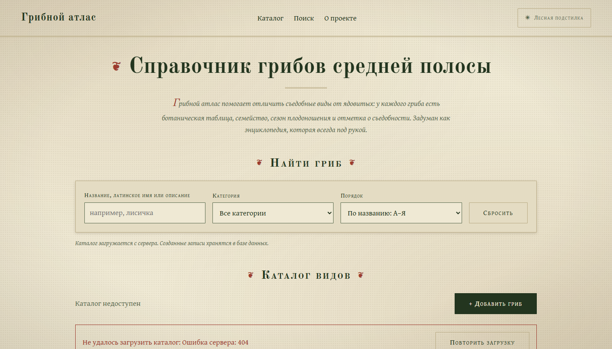
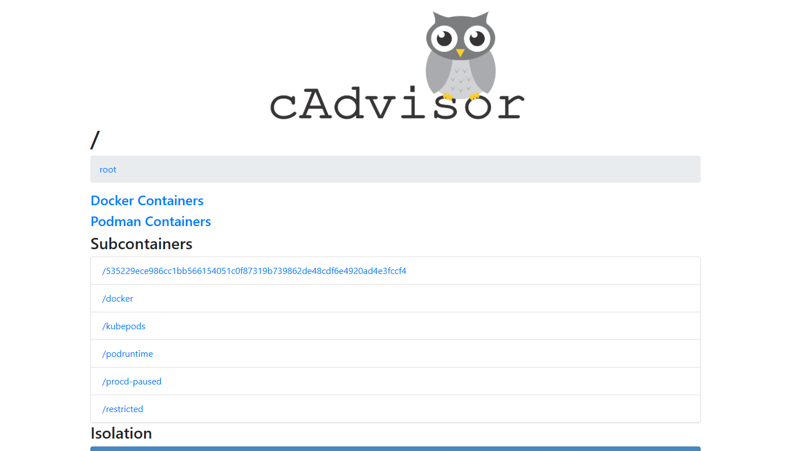
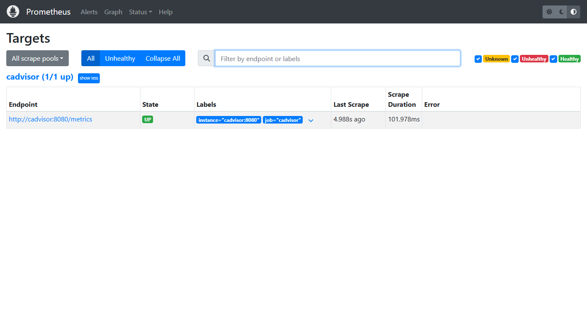
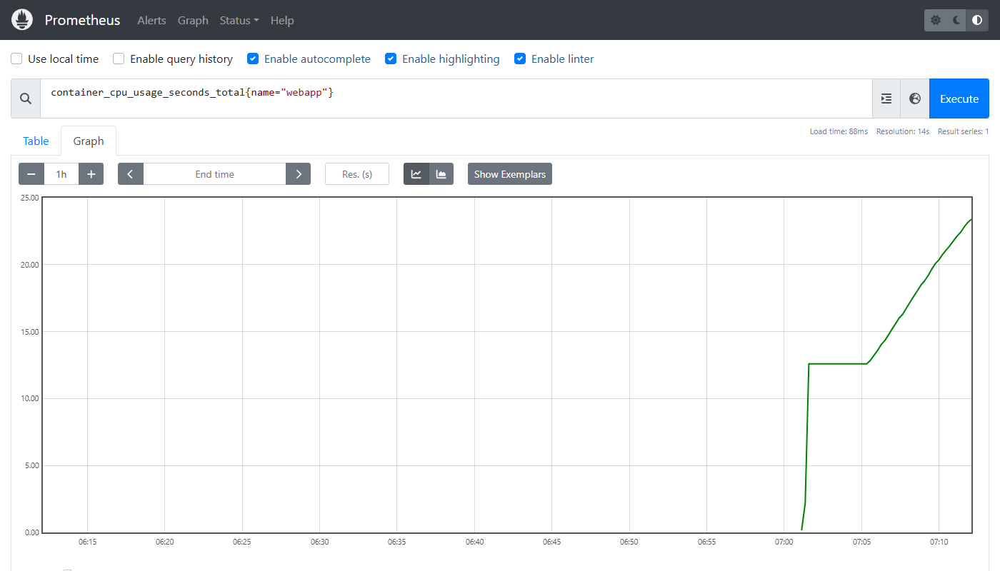
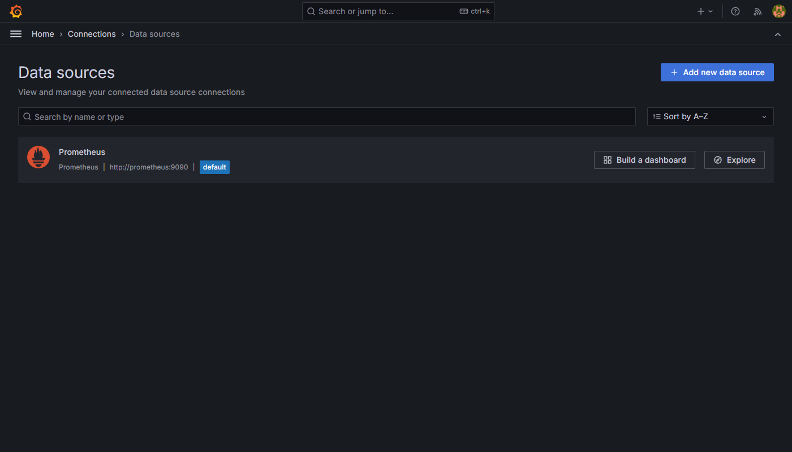
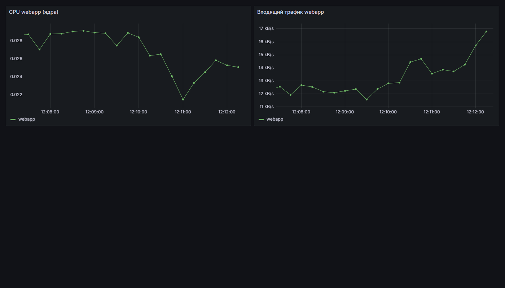
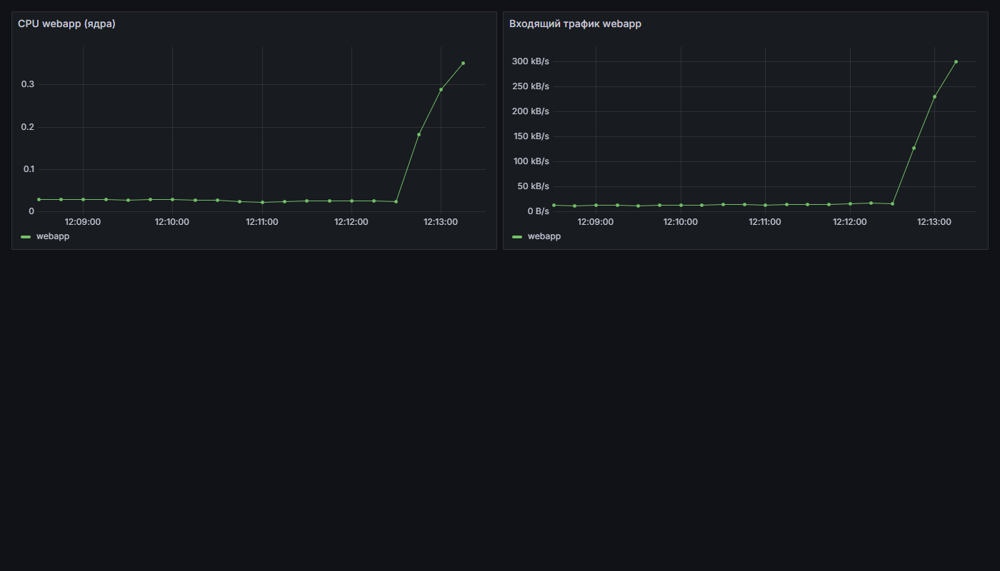
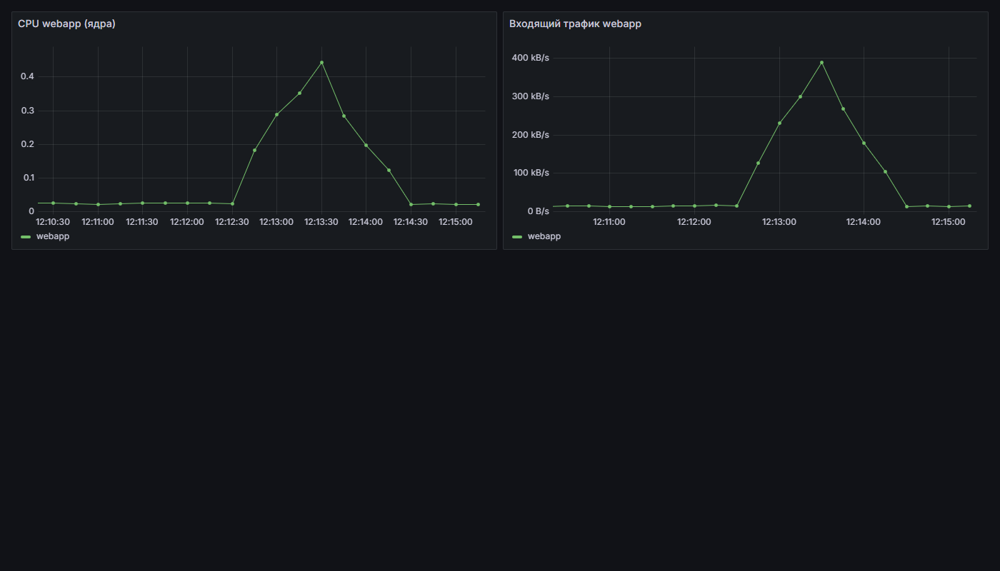

# Мониторинг контейнера: cAdvisor + Prometheus + Grafana

[English version](README.en.md)

Стек мониторинга Docker-контейнеров. Тестовое приложение `webapp` (nginx с сайтом грибного атласа) работает в контейнере. Метрики его контейнера собирает cAdvisor, хранит Prometheus, а Grafana рисует по ним графики.

```text
webapp  ←  cAdvisor (измеряет)  ←  Prometheus (опрашивает и хранит)  ←  Grafana (графики)
```

## Состав

| Сервис | Образ | Адрес | Назначение |
|---|---|---|---|
| webapp | nginx:alpine | http://localhost | тестовое приложение |
| cAdvisor | ghcr.io/google/cadvisor:v0.53.0 | http://localhost:8080 | метрики контейнеров |
| Prometheus | prom/prometheus:v2.53.0 | http://localhost:9090 | хранение метрик, PromQL, targets |
| Grafana | grafana/grafana:11.1.0 | http://localhost:3000 | дашборды (`admin` / `admin`) |

Все контейнеры работают в одной Docker-сети `monitoring`, поэтому находят друг друга по имени (`cadvisor`, `prometheus`).

## Файлы

```text
monitoring/
├── docker-compose.yml   описание четырёх сервисов и сети
├── prometheus.yml       что и как часто собирать (cadvisor:8080 каждые 5 с)
├── load.py              нагрузочный тест: 40 потоков, 60 секунд
├── screenshots/         скриншоты для отчёта
├── README.md            этот файл (русский)
└── README.en.md         English version
```

## Запуск

Нужен Docker Desktop.

```bash
docker compose up -d
docker ps
```

Остановка: `docker compose down`.

> **Важно для Docker Desktop.** Если в Settings → General включено «Use containerd for pulling and storing images», cAdvisor не видит контейнеры по именам (метрик `name="webapp"` не будет). Отключите эту настройку и перезапустите Docker Desktop.

## Ход работы и результаты

### 1. Контейнеры запущены

Все четыре контейнера в статусе Up (`screenshots/docker-ps.txt`):

```text
grafana      Up
prometheus   Up
webapp       Up
cadvisor     Up (healthy)
```



### 2. cAdvisor

Веб-интерфейс http://localhost:8080 видит контейнеры и показывает их метрики.



### 3. Prometheus: Status → Targets

Источник `cadvisor` имеет статус **UP**.



Тестовый запрос `container_cpu_usage_seconds_total{name="webapp"}` возвращает данные:



### 4. Grafana: источник данных

Data source Prometheus, URL `http://prometheus:9090` (имя контейнера, а не `localhost`). Save & test проходит успешно.



### 5. Дашборд «webapp: нагрузка»

Две панели, диапазон «Last 5 minutes»:

- CPU: `rate(container_cpu_usage_seconds_total{name="webapp"}[1m])`
- входящий трафик: `rate(container_network_receive_bytes_total{name="webapp"}[1m])`

**Нормальная работа:**



### 6. Нагрузка

```bash
python load.py
```

Скрипт 60 секунд шлёт запросы на http://localhost в 40 потоков (около 36 000 запросов).

**Во время нагрузки:**



**Через ≈100 секунд после остановки:**



### Наблюдения

| Состояние | CPU webapp (ядра) | Входящий трафик |
|---|---|---|
| Норма | ≈ 0,02–0,03 | ≈ 12–17 КБ/с |
| Под нагрузкой | до ≈ 0,42 | до ≈ 373 КБ/с |
| После остановки (≈100 с) | ≈ 0,02 | ≈ 13 КБ/с |

- При старте нагрузки CPU вырастает примерно в 15–20 раз, трафик примерно в 25–30 раз.
- После остановки метрики возвращаются к исходным значениям. Спад занимает около минуты: формула `rate(...[1m])` усредняет данные за последнюю минуту, поэтому график снижается плавно.
- Интервал сбора 5 секунд, поэтому изменения видны почти сразу.
- Скриншот «нормы» снят при небольшом фоновом трафике (≈12 КБ/с).
